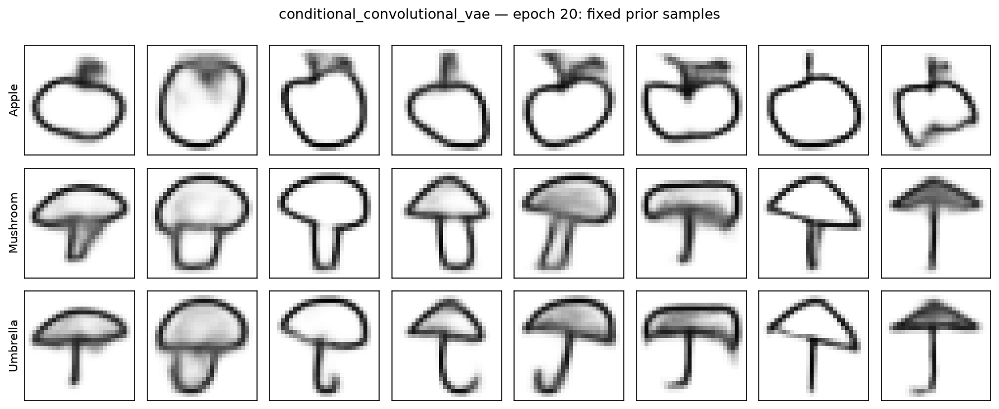
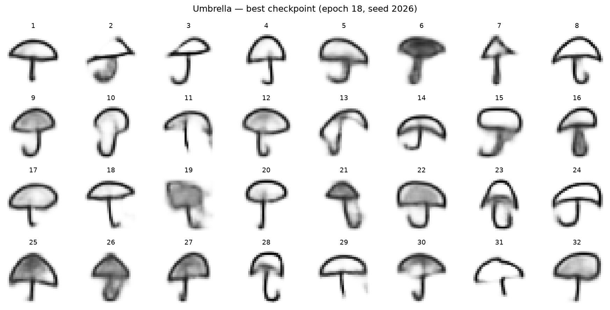

# Category-Controlled Sketch Generation with VAEs

**Author: Ashwin Parthasarathy**

Generate apple, mushroom, and umbrella sketches using convolutional variational autoencoders implemented and trained from scratch in PyTorch. This project combines controlled model comparisons with reproducible data preparation, held-out evaluation, and an explicit review of generation failures.

The selected model achieved **90.37% requested-category agreement** across 3,000 unfiltered generated sketches. This measures classifier-based recognizability—not the percentage of visually good images. Blur, incomplete outlines, and mushroom–umbrella ambiguity remain visible limitations.



*Training-stage preview at epoch 20; final evaluation uses the epoch-18 checkpoint selected by validation loss. The same latent vector is reused down each column while the category label changes. No samples are filtered.*

## Results

| Measure | Result | Interpretation |
|---|---:|---|
| Selected VAE validation loss | 162.4108 | Lowest validation BCE + KL, epoch 18 |
| Selected VAE test loss | 162.3114 | Average over 9,000 held-out images |
| Test reconstruction loss | 140.0546 | Pixel BCE summed over pixels, averaged over images |
| Test KL divergence | 22.2567 | Latent KL summed over dimensions, averaged over images |
| Classifier accuracy on real test images | 96.54% | Separate classifier trained only on real training sketches |
| Generated requested-category agreement | 90.37% | Frozen classifier, 1,000 generated samples per category |

| Requested category | Generated-category agreement |
|---|---:|
| Apple | 97.7% |
| Mushroom | 86.2% |
| Umbrella | 87.2% |

Mushroom–umbrella swaps account for 266 of 289 generated-category disagreements. The classifier's errors on real sketches and the visual differences between real and generated images limit how this proxy should be interpreted.

[Final evaluation summary](runs/conditional_vae_20261110T173806_903113Z/reports/final_evaluation/evaluation_summary.csv) · [Generated-category predictions](runs/category_evaluator_20261110T174338_742179Z/reports/generated_category_predictions.csv)

## Dataset

The project uses human-drawn sketches from [Google Quick, Draw!](https://github.com/googlecreativelab/quickdraw-dataset), downloaded as flattened 28 × 28 grayscale bitmaps. Pixels are scaled to [0, 1]; there is no random image augmentation.

| Category | Training | Validation | Test |
|---|---:|---:|---:|
| Apple | 24,000 | 3,000 | 3,000 |
| Mushroom | 24,000 | 3,000 | 3,000 |
| Umbrella | 24,000 | 3,000 | 3,000 |
| **Total** | **72,000** | **9,000** | **9,000** |

Preparation removes blank images and exact pixel duplicates before sampling. A shared hash inventory prevents exact duplicates across selected categories and splits. The initial apple split is preserved when the other categories are added. Source URLs, SHA-256 hashes, audit results, and split manifests are recorded. Artist independence and near-duplicate independence are not established.

Raw images are downloaded by the notebook and excluded from Git. Dataset use is governed by **CC BY 4.0**, separately from the code license.

## Models and experiments

The baseline encoder uses two strided convolutions with 32 and 64 channels, followed by a 128-unit dense representation. Separate heads estimate posterior mean and log variance. The decoder uses dense layers, nearest-neighbor upsampling, and convolutions to return pixel logits.

The conditional model supplies a one-hot category label to both encoder and decoder. All VAEs optimize **reconstruction BCE + KL divergence**, using Adam at learning rate 0.001 and batch size 128. BCE uses grayscale intensities as soft targets; the loss is not a direct perceptual-quality measure.

Development starts with an apple-only VAE trained for five epochs and continued to 20 total. Three conditional experiments then use the same data splits and 20-epoch budget:

| Conditional model | Parameters | Best epoch | Validation loss |
|---|---:|---:|---:|
| Original conditioning, latent 16 | 855,201 | 18 | **162.4108** |
| Original conditioning, latent 32 | 861,377 | 20 | 168.3166 |
| Category maps throughout decoder, latent 16 | 856,524 | 20 | 164.2497 |

Neither extra latent dimensions nor repeated decoder conditioning improved the observed validation objective. These are single-seed comparisons, not evidence that one architecture is universally superior. Model selection was completed before held-out testing.

[Comparison results](runs/conditional_vae_spatial_20261110T174133_220775Z/reports/model_comparison.csv)

## Evaluation beyond loss

- **Prior samples:** unfiltered fixed grids show category control and failure cases separately from input reconstructions.
- **Category recognition:** a frozen CNN is validated on real sketches before evaluating 3,000 generated images.
- **Training-image similarity:** 32 generated images per category are compared with all 24,000 same-category training images using pixel MSE. These distances do not prove novelty or rule out memorization.
- **Latent interpolation:** one fixed path illustrates gradual changes in decoder output; it does not establish distribution coverage.
- **Held-out evaluation:** the selected VAE and frozen classifier are evaluated on the 9,000 reserved test sketches without further tuning.



*All 32 samples from the fixed epoch-18 umbrella review, including ambiguous handles, blurred regions, and incomplete outlines.*

## Reproduce in Jupyter

The completed notebook was run with **Python 3.14.0, PyTorch 2.15.0, and Apple MPS** on an Apple M5 Pro with 24 GiB unified memory. It selects CUDA when available, then MPS, then CPU. The frozen requirements capture the recorded macOS environment; other platforms may require platform-specific dependency adjustments.

```bash
git clone https://github.com/ashlabs/sketch-generation-vae.git
cd sketch-generation-vae
git switch develop
python3.14 -m venv .venv
source .venv/bin/activate
python -m pip install -r requirements.txt
python -m ipykernel install --user \
  --name sketch-generation-vae \
  --display-name "Python (sketch-generation-vae)"
jupyter lab
```

Open **[generative_model.ipynb](generative_model.ipynb)** from the repository root, select **Python (sketch-generation-vae)**, and use **Restart Kernel and Run All**.

The notebook downloads missing source files, audits and splits the data, trains every recorded experiment, and performs evaluation in order. Each run writes a new timestamped directory. Training cells reject accidental repeated updates; they are not an automatic interrupted-run resume interface. Checkpoints are generated locally and are not distributed in the repository.

The reorganized notebook was rerun from a fresh kernel, with all 44 code cells executed sequentially and no saved errors. Reported comparison and final metrics reproduced at the displayed precision. Seeds control sampling, but identical results across devices or software versions are not guaranteed.

Recorded interpretation blocks describe the completed reference study; tables and plots emitted by code describe the current execution. Changing model settings does not automatically rewrite the reference-study prose.

## Repository contents

| Path | Purpose |
|---|---|
| `generative_model.ipynb` | Full implementation, experiments, and evaluation |
| `requirements.txt` | Frozen development environment |
| `data/processed/` | Reproducible image-selection manifests |
| `reports/` | Source provenance, audits, and earlier held-out reports |
| `figures/` | Dataset previews |
| `runs/` | Experiment-specific configurations, histories, figures, and evaluations |
| `data/raw/`, `checkpoints/` | Local artifacts excluded from Git |

The verified rerun's selected-model results are under `runs/conditional_vae_20261110T173806_903113Z/`; its final held-out reports are in `reports/final_evaluation/` **within that run directory**. Earlier experiment evidence remains available in other timestamped directories.

## Limitations and responsible use

The 28 × 28 raster format limits detail. Generated sketches can be recognizable yet contain smeared strokes, missing contours, or ambiguous structures. The project has no human quality study, repeated-seed comparison, quantitative distribution-coverage metric, or conclusive memorization analysis. A three-way classifier always chooses a known category and cannot certify that an output is a valid sketch.

Quick, Draw! reflects voluntary game participation and does not establish representative coverage of artists or cultures. Credit the dataset when redistributing examples, identify outputs as generated, and present this as an educational category-controlled generator rather than a production-quality illustration system. Higher-resolution or stroke-based generation and broader evaluation are future work.

## References and licenses

- Google Creative Lab. (n.d.). *The Quick, Draw! dataset* [Data set]. https://github.com/googlecreativelab/quickdraw-dataset
- Kingma, D. P., & Welling, M. (2014). *Auto-encoding variational Bayes*. International Conference on Learning Representations. https://arxiv.org/abs/1312.6114

Code: [MIT License](LICENSE). Dataset: [Creative Commons Attribution 4.0](https://creativecommons.org/licenses/by/4.0/).
